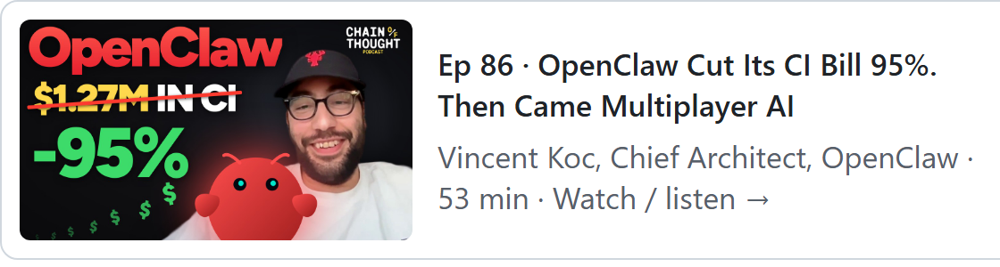
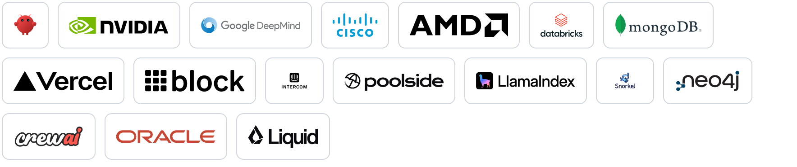

# Conor Bronsdon

I host [Chain of Thought](https://chainofthought.show/?utm_source=github&utm_medium=referral&utm_campaign=repo-readme&utm_content=profile-readme), a podcast where the people building AI infrastructure, agents and evals walk through what they're actually shipping. I also build open-source tools for people who work with AI agents. Most of them started as tooling for the show.

  Follow for new tools and what I learn maintaining them.

## Start here

| | |
| --- | --- |
| 🎙️ **Listen** | [Chain of Thought](https://chainofthought.show/podcast/?utm_source=github&utm_medium=referral&utm_campaign=repo-readme&utm_content=profile-readme): new episodes weekly on [YouTube](https://www.youtube.com/@ChainOfThoughtAI), [Apple](https://podcasts.apple.com/us/podcast/chain-of-thought-ai-agents-infrastructure-engineering/id1776879655) and [Spotify](https://open.spotify.com/show/4axe6uydH3PT0Fy1jemjFT) |
| 🔌 **Ask the show** | [chain-of-thought-podcast-mcp](https://github.com/conorbronsdon/chain-of-thought-podcast-mcp): search and cite every episode transcript from your agent. No login. |
| ✍️ **Write like a human** | [avoid-ai-writing](https://github.com/conorbronsdon/avoid-ai-writing) : audit and rewrite AI writing patterns |
| 🧠 **Give agents memory** | [agent-context-os](https://github.com/conorbronsdon/agent-context-os): identity, decisions and handoffs in reviewable Markdown, shared across coding agents |

## Chain of Thought

The badges read the show's public stats feed, so they stay current without anyone editing this page.

**Latest episode**

**Guests from**

The show's tooling is public too:

- [chain-of-thought-podcast-mcp](https://github.com/conorbronsdon/chain-of-thought-podcast-mcp): search and cite indexed episode transcripts. Point any MCP client at `https://mcp.chainofthought.show/mcp`.
- [podcast-benchmark](https://github.com/conorbronsdon/podcast-benchmark): compare any podcast with its peers on cadence, transcripts and feed hygiene, using only public data.
- Podcast analytics over MCP: [op3-mcp](https://github.com/conorbronsdon/op3-mcp), [apple-podcasts-mcp](https://github.com/conorbronsdon/apple-podcasts-mcp), [yt-analytics-mcp](https://github.com/conorbronsdon/yt-analytics-mcp), [gsc-mcp](https://github.com/conorbronsdon/gsc-mcp) and [podcastindex-mcp](https://github.com/conorbronsdon/podcastindex-mcp).
- [postlint-mcp](https://github.com/conorbronsdon/postlint-mcp): check a social post against each platform's real character limits.

## What I'm building

| | Project | What it does |
| --- | --- | --- |
| Context & memory | [agent-context-os](https://github.com/conorbronsdon/agent-context-os) | Keep identity, projects, decisions and session handoffs in reviewable Markdown, shared across Claude Code, Codex and other coding agents. Backed by Git. |
| | [agent-memory-kit](https://github.com/conorbronsdon/agent-memory-kit) | A read-only curator that finds rot and contradictions in agent memory and proposes evidence-cited diffs you review. |
| Check & prove | [ssot-check](https://github.com/conorbronsdon/ssot-check) | Find facts hand-copied across docs that have drifted from their one canonical home. |
| | [repo-audit](https://github.com/conorbronsdon/repo-audit) | For every claim that something is blocked or guaranteed, find the mechanism and grade it Enforced, Advisory or Guidance. |
| Write & publish | [avoid-ai-writing](https://github.com/conorbronsdon/avoid-ai-writing) | Audit and rewrite AI writing patterns. Also a [Chrome extension](https://chromewebstore.google.com/detail/avoid-ai-writing/blgifnkgdfbihjjclpddmjlnidbdihhl) and an [MCP server](https://github.com/conorbronsdon/avoid-ai-writing-mcp). |
| | [substack-mcp](https://github.com/conorbronsdon/substack-mcp) | Work on Substack drafts, Notes and analytics from an agent. |

More at [conorbronsdon.com/builds](https://conorbronsdon.com/builds?utm_source=github&utm_medium=referral&utm_campaign=repo-readme&utm_content=profile-readme): MCP servers ([gws-mcp-server](https://github.com/conorbronsdon/gws-mcp-server) and the podcast servers), agent skills, writing and creator tools, archived Mojo libraries, and a few things built for fun.

## About me

Previously built developer ecosystems at [Modular](https://www.modular.com/) ([acquired by Qualcomm](https://www.modular.com/blog/qualcomm-completes-acquisition-of-modular)), [Galileo](https://galileo.ai/) ([acquired by Cisco](https://blogs.cisco.com/news/cisco-announces-the-intent-to-acquire-galileo)) and LinearB, and before that was an enterprise consultant at Microsoft. I write pre-seed and seed angel checks into AI infrastructure, developer tools and robotics ([more](https://conorbronsdon.com/angel-investing?utm_source=github&utm_medium=referral&utm_campaign=repo-readme&utm_content=profile-readme)) and keep [ai-angels](https://github.com/conorbronsdon/ai-angels), a community list of active AI angels.

Away from that: Twilight Imperium, Age of Empires II, dancing, and a former chess nerd. I live in Tumwater, WA with my wife and our two cats.

[Podcast](https://chainofthought.show/?utm_source=github&utm_medium=referral&utm_campaign=repo-readme&utm_content=profile-readme) | [Newsletter](https://newsletter.chainofthought.show/) | [Writing](https://conorbronsdon.com/?utm_source=github&utm_medium=referral&utm_campaign=repo-readme&utm_content=profile-readme) | [LinkedIn](https://www.linkedin.com/in/conorbronsdon/) | [X](https://x.com/conorbronsdon)
